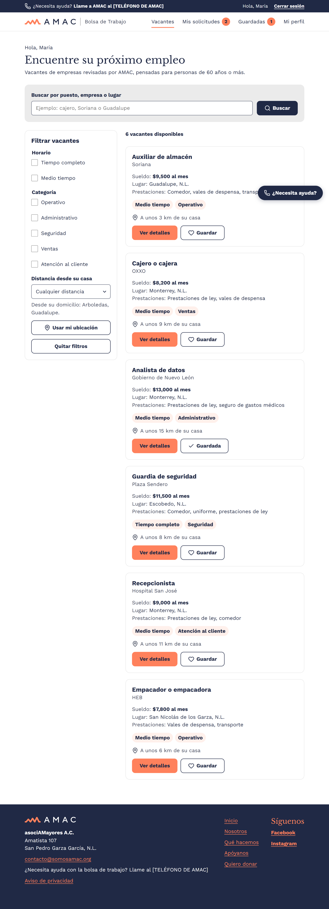
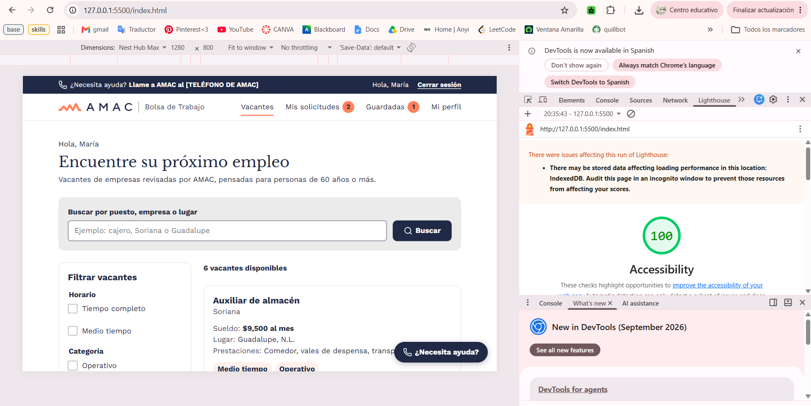

# Bolsa de Trabajo AMAC

Sitio de bolsa de trabajo para personas de 60 años o más, hecho para asociAMayores A.C. Está escrito a mano en HTML y CSS, sin frameworks.

**Sitio en línea:** [PEGAR AQUÍ EL LINK DE VERCEL]

## Integrantes

| Integrante | Qué hizo |
|---|---|
|  Anyelina Montoya  | Base del CSS (`variables.css`, `base.css`, `layout.css`), encabezado y pie de página, `index.html`, `vacante.html` y `solicitud-enviada.html` |
| Eugenia Guerrero | `login.html`, `registro-candidato.html` y `registro-empresa.html` |
| Isabella González | `mis-solicitudes.html`, `empresa-vacantes.html`, `solicitudes-recibidas.html` y `404.html` |

`componentes.css` lo hicimos entre las tres: empezamos con una base y cada una le fue agregando y ajustando estilos conforme armaba sus páginas en HTML.

## Paleta de colores

| Variable | Color | Uso |
|---|---|---|
| `--coral` | `#FF815C` | Botón principal, línea del menú activo, enlaces del pie |
| `--marino` | `#202945` | Texto, barra de ayuda y pie de página |
| `--texto-2` | `#3D4457` | Texto secundario (gris) |
| `--fondo` | `#FFFFFF` | Fondo de las páginas |
| `--gris` | `#EBEBEB` | Tarjetas grises y bordes de tarjetas |
| `--borde` | `#73798A` | Borde de los campos de formulario |
| `--exito` / `--exito-fondo` | `#1E6B34` / `#E6F4EA` | Estatus "Aceptada" y "Activa" |
| `--error` / `--error-fondo` | `#B3261E` / `#FDECEA` | Estatus "Rechazada" |
| `--aviso` / `--aviso-fondo` | `#7A4F00` / `#FDDAAD` | Estatus "En revisión" y "Pausada" |
| `--azul-amac` | `#CAE4EF` | Estatus "Enviada" |

## Tipografías (obtenidas de información dada por AMAC)

| Variable | Fuente | Uso |
|---|---|---|
| `--fuente-titulos` | Libre Baskerville | Títulos (`h1`) |
| `--fuente-texto` | Work Sans (400 y 700) | Todo el demás texto |

El texto base mide 18px en celular y 20px en computadora (en `rem`). Las fuentes vienen de Google Fonts.

## Componentes reutilizables

Todos están en `componentes.css`, salvo los últimos cuatro, que están en `layout.css`.

| Componente | Clase | Dónde se usa |
|---|---|---|
| Botón | `.boton` (`--coral`, `--secundario`, `--oscuro`, `--bloque`) | Todas las páginas |
| Tarjeta | `.tarjeta` (`--gris`, `--fila`, `--candidato`) | Vacantes, solicitudes, resumen, formularios |
| Etiqueta de estatus | `.etiqueta-estatus` (`--enviada`, `--revision`, `--aceptada`, `--rechazada`, `--activa`, `--pausada`, `--cerrada`) | Mis solicitudes, panel de empresa |
| Etiqueta de experiencia | `.etiqueta-experiencia` | Vacantes, solicitudes recibidas |
| Campo de formulario | `.campo-formulario` | Login, registros, filtros |
| Pasos del registro | `.pasos` | Registro de candidato |
| Mensaje | `.mensaje` (`--aviso`, `--exito`) | Detalle de vacante, formularios |
| Ventana de confirmación | `.ventana` | Pausar y cerrar vacante, retirar solicitud |
| Encabezado de tabla | `.tabla-cabecera` | Mis solicitudes, panel de empresa |
| Encabezado y menú | `.encabezado`, `.nav-principal`, `.menu-movil` | Todas las páginas |
| Barra de ayuda | `.barra-ayuda` | Todas las páginas |
| Pie de página | `.pie` | Todas las páginas |
| Botón de ayuda flotante | `.boton-ayuda` | Todas las páginas |

## Capturas de index.html

| Celular | Escritorio |
|---|---|
|   |  |

## Lighthouse: Accesibilidad

## Notas

- `vacante.html` es un ejemplo: todas las tarjetas del listado llevan a esa misma página.
- La búsqueda, los filtros y botones como Guardar, Pausar o Mostrar contraseña todavía no funcionan, porque esta entrega es solo HTML y CSS.
- Los enlaces con `href="#"` son de páginas que todavía no existen.
- `header-footer.html` es la plantilla del encabezado y el pie que usamos para armar las páginas, ademas del menu de la compu, el celular y los mensajes de llamar.
- Iconos de [Lucide](https://lucide.dev). Fuentes de [Google Fonts](https://fonts.google.com).